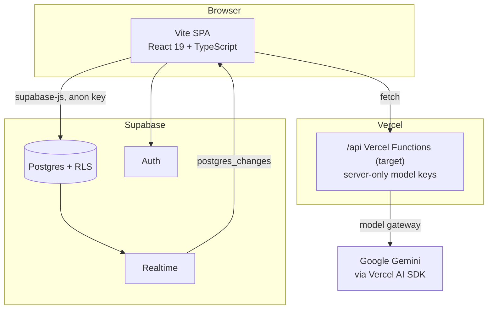
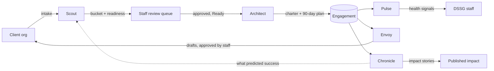

# DSSG Success Portal

The partner portal for **Data Diplomats / DSSG NYC** (Data Science for Social Good). It serves two audiences with one codebase.

## Purpose

### Part 1 — A human-centered AI education journey for pro bono clients

The platform is where pro bono nonprofit clients register and start a human-centered AI education journey. It promises:

- **Best practices** for adopting data and AI responsibly, shaped by each organization's readiness, not a one-size-fits-all syllabus.
- **A curated list of resources, tools, and courses**, matched to where the client is on the maturity model.
- **Hands-on practice.** The app's grant tools double as practice: a client learns by using the same tools that help it pursue funding, not by reading about them.

### Part 2 — Project management and volunteer-to-client matching for Data Diplomats

The platform also runs the Data Diplomats side of the work: tracking each engagement through its lifecycle and matching volunteers to the clients that fit them.

The built-in AI agents are the reason this scales. **The AI handles repetitive work (triage, scoring, drafting, monitoring); people handle judgment (approving, deciding, building the relationship).** An agent never changes state on its own authority. It produces a proposal that deterministic code checks and a human authorizes (see [Human-in-the-loop](#human-in-the-loop-ai-proposes-people-decide)).

### Status

| Capability | State |
|---|---|
| Client registration, dashboard, six-stage engagement roadmap | Built |
| Public intake (Scout), staff review queue | Built |
| Assessment, maturity scoring, charter + 90-day plan (Architect) | Built |
| Engagement health (Pulse), partner drafts (Envoy), impact stories (Chronicle) | Logic + tests built; **not yet wired into the UI** |
| Server boundary (`/api`) for model calls | Target — not written yet |
| Learning journey: curated resources, tools, courses | Target — not built |
| Grant tools as guided practice | Target — "Grant Projects" is a placeholder link today |
| Volunteer-to-client matching | Target — specified in the access model, not built |

Check the tree before trusting this table; the platform lands one piece at a time. The decision record and agent roster live in [.claude/specs/design-system.md](.claude/specs/design-system.md).

## Tech Stack

| Layer | Technology |
|---|---|
| Framework | React 19 + Vite 6 + TypeScript (SPA, not Next.js) |
| Routing | React Router 7 (`BrowserRouter`) |
| Styling | Tailwind CSS 4 (via `@tailwindcss/vite`), see [design.md](design.md) |
| Animation / icons | Motion, lucide-react |
| Auth & database | Supabase: Postgres, Auth (Email/Password + Google), RLS, Realtime |
| Agents | Vercel AI SDK (`ai` + `@ai-sdk/google`, Gemini by default) behind `src/model/gateway.ts` |
| Server | Vercel Functions under `/api` *(target)* |
| Tests | Vitest (`src/**/__tests__/*.test.ts`), pgTAP for RLS |
| Hosting | Vercel, https://nonprofit-success-ai-chi.vercel.app (deployed by `.github/workflows/cd.yml`) |

## Architecture

### System containers



- **RLS is the authorization boundary.** The SPA reads and writes Supabase directly with the public anon key; Postgres policies decide what each caller can see.
- **`/api` exists for what the browser must not do:** hold model keys and call the model. No secret reaches the client. Only `VITE_`-prefixed variables are bundled, and model keys are never prefixed. Until `/api` lands, agent paths run their deterministic fallback locally.
- **Realtime is UI synchronization, not an event bus.** A workflow step never depends on a client having received an event.

### The five agents

| Agent | Job | Model call? | In this tree |
|---|---|---|---|
| **Scout** | Triage intake into a bucket, confidence, and readiness signal; will also absorb meeting intelligence | Yes, with a heuristic fallback | `src/agents/scout/`, UI built |
| **Architect** | 18-question assessment, maturity score, charter and 90-day plan | Scoring is a deterministic rubric; narrative enrichment is the future model call | `src/agents/architect/`, UI built |
| **Pulse** | Per-engagement health verdict, computed on read | No, by design | `src/agents/pulse/`, no UI |
| **Envoy** | Draft partner communications | Yes (drafting), always human-approved | `src/agents/envoy/`, no UI, no send path |
| **Chronicle** | Impact statements and case studies, gated on a readiness check | Yes | `src/agents/chronicle/`, no UI |

The **Contract & Consent Gate** is a shared service (server-stamped signature, immutable write), not an agent. It is specified but not built.



### Human-in-the-loop: AI proposes, people decide

> **AI proposes; deterministic code decides; humans authorize; events record; outcomes teach the system.**

- **HITL tiers.** `L2` means high confidence and a Ready signal: the agent acts, a human is notified, and the action is reversible. `L3` is everything else: the agent drafts and a human approves before anything reaches a client. The tier is derived server-side in `src/guardrails/hitl.ts` and omitted from every model output schema, so a model cannot grant itself a tier.
- **Every agent path has a deterministic fallback.** A pure local heuristic produces a usable result when the model call fails. Failure is signalled, never simulated: callers can tell "the agent decided" from "the agent could not run".
- **The adversarial test.** For any new agent path, ask what state the model could change if it returned adversarial output. The answer must be "none".

### Source layout

Concept layers are flat under `src/`. Dependencies point one way:

```
app/, components/  ──┐
                     ├──> agents/ ──> {model, guardrails, observability, schemas}
api/               ──┘
```

Nothing in the agent or generic layers imports from `app/` or `components/`, so `api/` can import agent logic without pulling in React.

```
├── src/
│   ├── app/                  # SPA entrypoint: App.tsx (router, auth, demo mode), main.tsx, index.css
│   ├── components/           # Screens by feature: auth/, dashboard/, business/, scout/, architect/
│   ├── agents/               # One directory per agent: scout/, architect/, pulse/, envoy/, chronicle/
│   │   └── {agent}/          #   schema.ts + logic; tests in __tests__/ beside the source
│   ├── model/                # Gateway: the single place a model is called (gateway.ts, errors.ts)
│   ├── guardrails/hitl.ts    # L1–L4 tier derivation, one switch over the whole roster
│   ├── observability/        # recorder.ts writes agent_runs (service role, server-only)
│   ├── schemas/              # Versioned wire contracts crossing /api
│   ├── types/                # Shared domain and wire types, barrel at types/index.ts
│   └── lib/                  # supabase.ts (client, liveQuery, mapping), demoStore.ts
├── api/                      # Vercel Functions (target; none written yet)
├── supabase/                 # config, migrations, pgTAP RLS tests, Firebase port provenance
├── docs/                     # Tracked product requirements and system design
└── .claude/specs/            # Design record, agent specs, CRM data model, stack guides
```

An `src/evals/` grading harness (heuristic and LLM-judge graders gated by `targets.yaml`) is specified in [.claude/specs/platform/infra/eval-harness.md](.claude/specs/platform/infra/eval-harness.md) but not yet ported.

### Routing and pages (`src/app/App.tsx`)

`App.tsx` owns the router, navbar, footer, and auth-state listener. It also implements **Demo Mode**, a client-side fake signed-in user that routes reads and writes to static mock data so the product can be explored with no account or database.

| Route | Component | Guard |
|---|---|---|
| `/login` | `auth/Login` | redirects to `/dashboard` if signed in |
| `/dashboard` | `dashboard/Dashboard` | requires `user` |
| `/business/:id` | `business/BusinessPortal` | requires `user` |
| `/apply` | `scout/ScoutIntakeForm` | public |
| `/scout/review` | `scout/ScoutReviewQueue` | `user` and `role === 'admin'` |
| `/architect/assess/:intakeId` | `architect/ArchitectAssessment` | `user` and `role === 'admin'` |
| `/architect/plan/:intakeId` | `architect/ArchitectPlan` | `user` and `role === 'admin'` |
| `/` | none | redirects to `/dashboard` or `/login` |

The role is read from `public.users` through RLS, which returns only the caller's own row. A null role fails closed.

### Data model and access control

Six tables, defined in [supabase/migrations/](supabase/migrations/): `users`, `businesses`, `engagements`, `engagement_events`, `scout_intakes`, `architect_assessments`. The full ER diagram and authorization semantics are in [.claude/specs/design-system.md](.claude/specs/design-system.md) §4.

| Table | Access |
|---|---|
| `users` | Self only; `role` is immutable after insert. Provisioned by the `on_auth_user_created` trigger with `role = 'client'`, so no signup path can skip it. |
| `businesses` | Owner-scoped. |
| `engagements` | Owner-scoped writes; admins can read all. One row per stage (`unique (business_id, stage)`), and a completed stage cannot be reopened. |
| `engagement_events` | Append-only: no update or delete policy, and the privileges are not granted either. |
| `scout_intakes` | The one public-write surface: `anon` may insert only with `review_status = 'pending'`. Read and update are admin-only. |
| `architect_assessments` | Admin-only. Primary key is the source `scout_intakes.id` (1:1). |

Engagements move through six stages: `initial_meeting → budget_check → data_ethics_committee → scoping → hackathon_ready → membership`. The threat model is in [.claude/specs/crm/security.md](.claude/specs/crm/security.md).

## Run Locally

**Prerequisites:** Node.js, Docker (for the local Supabase stack).

1. Install dependencies and the git hooks:
   ```
   npm install
   make hooks      # one-time; requires `brew install pre-commit`
   ```
   The hooks run secret detection (gitleaks), eslint on staged files, and guards against committing `.env` or a server-only key behind a `VITE_` prefix. The full gate (`make gate`: `type-check lint test build`) runs in CI on every PR.
2. Start the database and copy its credentials into `.env`:
   ```
   make db-start   # prints API_URL and ANON_KEY
   ```
   Copy [.env.example](.env.example) to `.env` and set `VITE_SUPABASE_URL` and `VITE_SUPABASE_ANON_KEY`. Both are required; the app throws on startup naming whichever is missing. No model key is needed to run the SPA: agent paths use their deterministic fallbacks. A model key (`GOOGLE_GENERATIVE_AI_API_KEY`) is server-only and is read by the gateway once `/api` exists.
3. Run the app:
   ```
   npm run dev
   ```

Other scripts: `npm run build`, `npm run preview`, `npm run type-check`, `npm run lint`, `npm run test`. `make dev-api` runs `vercel dev` to serve `/api` too.

No account? Use **Enter Demo Mode** on the login screen for sample data with live writes disabled.
